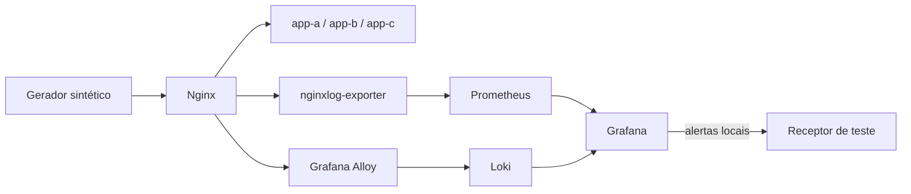
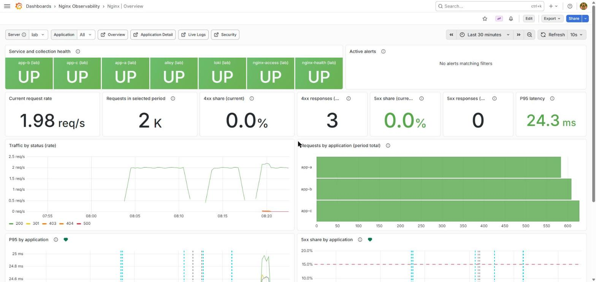
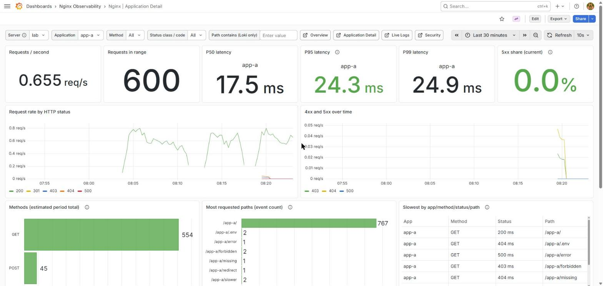
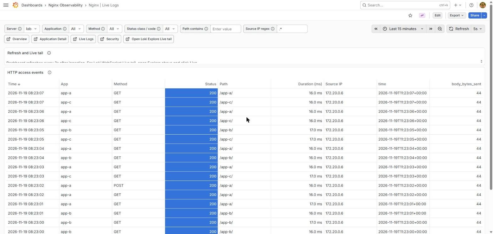
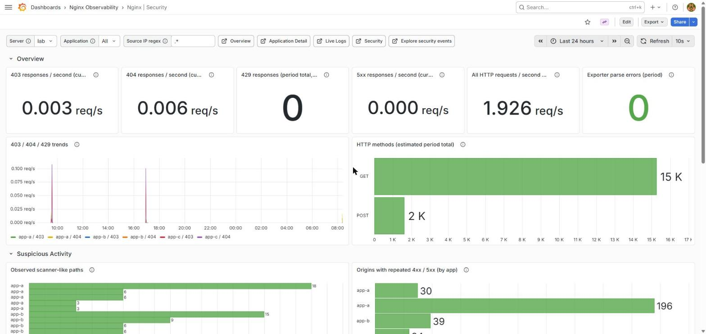

# Nginx Observability

Laboratório local, reproduzível e multiaplicação para explorar métricas HTTP, logs, dashboards e alertas de serviços publicados por Nginx. Todo o tráfego demonstrativo usa aplicações sintéticas na rede Docker local; o projeto não acessa ambientes corporativos.

## O que demonstra

- Instrumentação de três aplicações através de um único Nginx, com métricas e logs filtráveis por aplicação.
- Pipeline com Prometheus, Loki, Grafana Alloy e exporter de access logs.
- Quatro dashboards Grafana provisionados: Overview, Application Detail, Live Logs e Security.
- Alertas operacionais por aplicação e componente, com receptor webhook local para testes.
- Retenção configurável, rotação de logs por renomeação e testes de recuperação.
- Controles de laboratório: autenticação Grafana, portas publicadas em loopback e redes Docker segmentadas.
- Diferenciais técnicos: labels de baixa cardinalidade, consultas por aplicação, infraestrutura/dashboards/alertas como código e testes de recuperação.

## Arquitetura



Prometheus coleta métricas HTTP com labels de baixa cardinalidade, como `app`, `method` e `status`. Alloy envia eventos JSON ao Loki; endereços IP, caminhos e demais campos de requisição permanecem nos eventos/metadados estruturados, não como labels indexadas. O dashboard e as regras de alerta são provisionados por arquivos versionados.

## Requisitos

- Windows com Docker Desktop configurado para Linux containers e Docker Compose v2.
- Python 3.11 ou superior.
- Cerca de 2 GB de memória disponível ao Docker Engine.
- Portas locais 8080, 9090, 3100 e 3000 livres. Podem ser alteradas no `.env`.

## Release

A release `v0.1.0` é um laboratório local/portfólio, **sem homologação para produção**. O Loki roda numa reconstrução da v3.7.10 com Go `1.26.11` e a correção upstream do WAL (grafana/loki#25118), gerada pelo workflow `loki-image` e fixada por digest no `compose.yaml`; isso fecha o CVE-2026-97054 que havia sido aceito apenas para uso local. Voltar a uma imagem oficial assim que existir release corrigida. Consulte o [changelog](CHANGELOG.md) e as [notas da release](docs/release-v0.1.0.md).

## Executar

```shell
python scripts/init_lab_env.py
docker compose up -d --build
docker compose ps
```

O inicializador cria `.env`, ignorado pelo Git, com uma senha aleatória para Grafana e preserva configurações existentes. O usuário inicial é `admin`; consulte a senha localmente no arquivo privado `.env`. Ajuste portas, retenção e taxa do gerador copiando os valores documentados em `.env.example` para o `.env`.

| Serviço | Endereço local | Acesso |
|---|---|---|
| Grafana | <http://localhost:3000> | Login obrigatório |
| Prometheus | <http://localhost:9090> | API local |
| Loki | <http://localhost:3100> | API local |
| Aplicações | <http://localhost:8080/app-a/> (também `app-b` e `app-c`) | Proxy Nginx |

As portas administrativas e de API são vinculadas somente ao loopback. Exporter, Alloy e receptor não publicam portas no host.

## Dashboards e alertas

- **Nginx | Overview:** faixa de saúde dos serviços e da coleta, alertas ativos, volume, % de 4xx/5xx, latência P95 e comparação entre aplicações.
- **Nginx | Application Detail:** métricas e requisições da aplicação selecionada, incluindo métodos, rotas, latência e logs recentes.
- **Nginx | Live Logs:** eventos recentes com filtros e link para Explore; refresh periódico é diferente do Live tail WebSocket do Grafana Explore.
- **Nginx | Security:** padrões para triagem e investigação. Respostas 403/404/500 são sinais para análise, não classificação automática de ataque.

Alert rules ficam em **Grafana → Alerting → Alert rules**, na pasta **Nginx Operations**. Incluem disponibilidade, proporção de 5xx, P95, saúde do pipeline e uso dos blocos TSDB. Os limites ficam em `config/prometheus/rules/alert-thresholds.yml` como **valores padrão** aplicados automaticamente a todo par servidor/aplicação que gera tráfego; um par específico pode ser ajustado com um registro `_override` (exemplo no próprio arquivo). As cores dos dashboards usam os mesmos padrões, e os testes falham se divergirem.

Toda métrica e todo stream de log carregam o rótulo `server` (no laboratório, `lab`). Os quatro dashboards têm a variável **Server**; a opção All também inclui dados gravados antes da existência do rótulo.

Os JSONs em `config/grafana/dashboards/` são a fonte oficial dos dashboards: edite-os diretamente (ou exporte do Grafana) e rode `python tests/verify_pipeline.py`. O gerador `scripts/build_dashboards.py` foi aposentado porque havia divergido dos arquivos provisionados; o histórico Git o preserva. O contact point provisionado entrega apenas ao receptor de teste da rede Docker interna; ele não é uma integração de produção.

## Cenários sintéticos

O serviço `traffic-generator` mantém tráfego normal local. Para executar cenários finitos, pare-o, rode os comandos e inicie-o novamente:

```shell
docker compose stop traffic-generator
docker compose run --rm --no-deps traffic-generator python -u generate.py --scenario normal --duration 30 --rps 4 --concurrency 2
docker compose run --rm --no-deps traffic-generator python -u generate.py --scenario degradation --duration 60 --rps 4 --concurrency 2
docker compose run --rm --no-deps traffic-generator python -u generate.py --scenario scan --duration 30 --rps 4 --concurrency 2
docker compose run --rm --no-deps traffic-generator python -u generate.py --scenario peak --duration 30 --rps 8 --concurrency 2
docker compose run --rm --no-deps traffic-generator python -u generate.py --scenario latency --duration 60 --rps 2 --concurrency 2
docker compose start traffic-generator
```

Os cenários têm duração, taxa e concorrência limitadas; aceitam somente o Nginx local. A seed padrão é `42`. As respostas incluem 200, 301, 403, 404 e 500.

## Verificação

Com a stack em execução:

```shell
python tests/verify_pipeline.py --verify-scenarios --verify-persistence
python tests/verify_pipeline.py --verify-reliability
python tests/verify_alerting.py
python tests/verify_log_privacy.py
python tests/audit_repository_history.py
docker compose config --quiet
git diff --check
```

Os testes exercitam APIs Prometheus, Loki e Grafana, consultam os quatro dashboards, verificam isolamento por aplicação, cenários, WebSocket do Grafana Live, persistência, rotação/recuperação e transições/entrega local dos alertas. Os testes de disponibilidade e confiabilidade interrompem serviços locais por curtos períodos e os restauram ao final.

## Retenção, segurança e limites

Padrões: Prometheus 7 dias e até 1 GB de blocos TSDB; Loki 168 horas, com exclusão assíncrona via Compactor. O limite de blocos do Prometheus não limita sozinho WAL/head nem o volume Docker. Loki no backend filesystem não tem teto por bytes nem métrica confiável de espaço livre nesta stack. Reserve espaço adicional e mantenha backups externos antes de qualquer uso além do laboratório.

Novos access logs guardam IP de origem, aplicação, método, rota allowlisted ou `/_unclassified`, status, duração e bytes enviados. Query strings, usuário autenticado, Cookie, Authorization, Referer e User-Agent não são persistidos. O IP continua sendo dado pessoal; os volumes Loki e de logs locais também podem conter registros anteriores à sanitização até a retenção/rotação expirá-los. Use somente tráfego sintético, não publique volumes e defina minimização, acesso e retenção antes de qualquer coleta real. Prometheus e Loki não têm autenticação própria nesta configuração local e não devem ser expostos fora do host sem proxy autenticador, TLS e controles de rede apropriados.

O exporter não faz backfill: requisições durante sua indisponibilidade podem permanecer nos logs Loki, mas não são reconstruídas nos counters Prometheus. O volume Prometheus também apresentou avisos de recuperação de chunks mmap antes da atualização para 3.16.0. Após a atualização, os testes de restart/persistência passaram sem recorrência observada; uma lacuna histórica eventualmente descartada não pode ser reconstruída nem excluída sem fonte independente. Veja [a auditoria final](docs/final-audit.md) e [retenção e recuperação](docs/reliability-audit.md).

## Capturas

Capturas reais dos quatro dashboards (2026-11-19, `Server = lab`, tráfego sintético do laboratório):

| Overview | Application Detail |
|---|---|
|  |  |
| **Live Logs** | **Security** |
|  |  |

Capturas anteriores (2026-11-17), incluindo o filtro de path e o Live tail no Explore, continuam em [`docs/screenshots/`](docs/screenshots/). Não usamos respostas de API como substituto para capturas visuais.

## Licença

O arquivo [LICENSE](LICENSE) propõe MIT para o conteúdo próprio, mas a titularidade/autoridade de concessão ainda não foi confirmada pelo mantenedor; a publicação permanece bloqueada. As imagens e serviços externos mantêm licenças e avisos próprios, não substituídos pela MIT. Consulte a [auditoria de licenças](docs/license-audit.md) e os [SBOMs](docs/sbom/). Este laboratório não foi homologado para produção; confira o [preparo da release v0.1.0](docs/release-v0.1.0.md) e as [limitações técnicas](docs/final-audit.md).

## Mapa do repositório

- `compose.yaml`, `.env.example`: orquestração e parâmetros do laboratório.
- `LICENSE`, `CHANGELOG.md`: licença dos arquivos próprios e histórico da release preparada.
- `config/`: Nginx, Prometheus, Loki, Alloy, dashboards e provisionamento Grafana.
- `demo/`: aplicações, tráfego sintético e receptor local de alertas.
- `tests/`: verificações de pipeline, confiabilidade e alertas.
- `scripts/`: inicialização do ambiente, rotação de logs e resumo das varreduras Trivy.
- `docs/`: decisões, auditorias, procedimentos, resultados e limitações por marco.

Auditorias técnicas e evidências: [arquitetura](docs/architecture-research.md), [segurança](docs/security-audit.md), [dashboards](docs/dashboard-audit.md), [alertas](docs/alerting-audit.md), [retenção e recuperação](docs/reliability-audit.md) e [auditoria final](docs/final-audit.md).

A varredura Trivy da release e os SBOMs SPDX das 11 imagens examinadas estão em [`docs/sbom/`](docs/sbom/). A triagem dos findings restantes, com pré-condições e decisões, está em [`docs/cve-triage.md`](docs/cve-triage.md). Esses relatórios não são certificação de segurança nem substituem uma triagem de VEX e alcance do código.

## Encerrar

```shell
docker compose down
```

Isso preserva os volumes locais. Não use `docker compose down -v` se quiser manter as séries, logs e estado do Grafana.
